# Advanced Human Computer Interaction (AHCI) Usability & Accessibility Analysis
**Project:** Learning Sphere LMS  
**Date:** May 19, 2026  

---

## 1. Executive Summary

This report presents a thorough usability, accessibility, and interaction design analysis of the **Learning Sphere LMS** (covering the Login, Student, Teacher, and Admin portals). The evaluation is grounded in **Advanced Human-Computer Interaction (AHCI)** principles, including Jakob Nielsen's Usability Heuristics, W3C Web Content Accessibility Guidelines (WCAG 2.1 AA), Fitts's Law, Hick's Law, and modern UX design paradigms.

While the system implements a sleek, modern visual aesthetic using a curated pink/accent palette (`#e94560`, `#f91e63`) and dynamic dark sidebars, a deep code and architectural review reveals several **critical usability friction points, responsiveness issues, and accessibility barriers**.

### 🏆 Top 5 Critical Findings:
1. **Broken Mobile Navigation:** All dashboards hide the sidebar on mobile via `-translate-x-full`, but **no hamburger menu button exists** — mobile users are permanently locked out of navigation.
2. **High Admin Friction:** Admin enrollments require manually typing a student's numeric database ID — violating interaction efficiency and error-prevention.
3. **No Sorting/Pagination:** Large tables lack pagination and sorting — causing cognitive overload and performance degradation at scale.
4. **Native `alert()`/`confirm()` Dialogs:** Thread-blocking, visually outdated browser dialogs used for all error/success/confirmation flows.
5. **Accessibility Barriers:** Form inputs lack `<label>` elements, password toggle emojis lack `aria-label`, and no keyboard focus indicators exist.

---

## 2. Core AHCI Principles Referenced

| AHCI Principle | Description |
| :--- | :--- |
| **Visibility of System Status** | Keep users informed through appropriate feedback (loading states, toasts). |
| **Flexibility & Efficiency of Use** | Reduce user effort via accelerators (autocomplete, bulk actions, search filters). |
| **Consistency & Standards** | Uniform navigation, layout patterns, and visual tokens across all pages. |
| **Error Prevention & Recovery** | Eliminate error-prone conditions; confirmation before destructive actions. |
| **Aesthetic & Minimalist Design** | Remove irrelevant information; every element should serve a purpose. |
| **Accessibility (A11y)** | Semantic markup, keyboard navigation, ARIA labels, contrast compliance. |
| **Responsive Flexibility** | Layout adapts across devices while maintaining full functionality. |

---

## 3. System Architecture Overview

```mermaid
graph TD
    A[LMS Portal Usability Review] --> B[Login Page]
    A --> C[Student Landing]
    A --> D[Teacher Dashboard]
    A --> E[Admin Dashboard]
    A --> F[System-Wide Issues]
    
    B --> B1[Native Blocking Alerts]
    B --> B2[A11y Label Violations]
    B --> B3[No Loading States]
    
    C --> C1[Missing Mobile Toggle]
    C --> C2[Static Marketing Dashboard]
    C --> C3[No Course Filters/Search]
    C --> C4[No Attendance Filter]
    
    D --> D1[No Bulk Attendance]
    D --> D2[Marks Input No Validation]
    D --> D3[No Student Search in Attendance]
    
    E --> E1[Manual Student ID Entry]
    E --> E2[No Table Pagination]
    E --> E3[Static Dashboard Metrics]
    
    F --> F1[No Hamburger Menu - All Pages]
    F --> F2[alert/confirm Everywhere]
    F --> F3[No Skeleton Loaders]
```



---

## 4. Detailed Findings by Page

---

### 4.1. Login Page (`login.html` + `app.js`)

> [!NOTE]
> Clean, modern card design centered on a dark background. However, basic screen-reader support and non-blocking notification systems are absent.

| # | Component | AHCI Principle | Issue Found | Suggested Enhancement |
|---|:---|:---|:---|:---|
| L-1 | **Password Eye Toggle** | **Accessibility** | Button uses emoji `👁️`/`🙈` with no `aria-label`. Screen readers read "eye" or "see-no-evil monkey face." | Add `aria-label="Show password"` / `aria-label="Hide password"`. Toggle dynamically with visibility state. |
| L-2 | **Email & Password Inputs** | **Accessibility** | No associated `<label>` elements. Rely on `placeholder` only — placeholders vanish on typing, causing memory load. | Add `<label class="sr-only" for="loginEmail">Email</label>` for each input. |
| L-3 | **Login Submit Button** | **Visibility of System Status** | No loading state during API call. Slow responses give zero feedback; users double-click, causing duplicate requests. | Disable button on submit, show spinner, change text to "Logging in…". Re-enable on error. |
| L-4 | **Error/Success Feedback** | **Visibility of System Status** | All feedback uses native `alert()` — blocks thread, looks unpolished, breaks modern SPA flow. | Implement a **Toast Notification System** (slide-in, auto-dismiss, color-coded: green=success, red=error). |
| L-5 | **Forgot Password Role Select** | **Error Prevention** | User must manually select their role (Student/Teacher/Admin). Their institutional email already determines role. | Remove role dropdown. Backend should auto-detect role from email domain/pattern. |
| L-6 | **Browser Autofill Support** | **Efficiency of Use** | Inputs lack `autocomplete="email"` and `autocomplete="current-password"` attributes. Password managers can't pre-fill. | Add standard HTML `autocomplete` attributes to all credential inputs. |
| L-7 | **Form Reset on Failed Login** | **Error Prevention** | `loginForm.reset()` is called in the `finally` block — clears the email even on error, forcing users to re-type. | Only reset the form on successful login, not on failure. |

---

### 4.2. Student Landing Page (`student-landing.html` + `utils.js`)

> [!WARNING]
> Visually pleasing but suffers from complete mobile navigation failure and serves static marketing info instead of personalized student data.

| # | Component | AHCI Principle | Issue Found | Suggested Enhancement |
|---|:---|:---|:---|:---|
| S-1 | **Mobile Navigation** | **Responsive Flexibility** | Sidebar has `-translate-x-full lg:translate-x-0` — hidden on mobile. **No hamburger button exists in the header.** Mobile users cannot access any page. | Add a `<button id="mobileMenuToggle" class="lg:hidden">` with a hamburger icon in the header. Wire it to `openSidebar()`/`closeSidebar()` (already partially implemented in `utils.js`). Add a dark overlay for dismissal. |
| S-2 | **Dashboard Content** | **Aesthetic & Minimalist Design** | Dashboard shows static promotional stats ("1500+ Students", "98% Placement Rate") and a generic Unsplash image. These are irrelevant once logged in. | Replace with **Personalized Dashboard Widgets**: enrolled courses count, current CGPA gauge, next class reminder, pending quizzes/assignments checklist. |
| S-3 | **Course Catalog** (`#courses`) | **Flexibility & Efficiency (Hick's Law)** | All courses rendered in a flat grid. No search bar, no category filter, no sorting. With 50+ courses, scanning is exhausting. | Add: (1) **Search bar** with keyup debounce, (2) **Category dropdown** dynamically populated, (3) **Sort dropdown** (A-Z, Newest). |
| S-4 | **All Course Cards Same Image** | **Visual Hierarchy** | Every course card shows the same Unsplash stock image (`photo-1587620962725`). Cards look identical, making visual scanning ineffective. | Use varied placeholder images per category, or generate unique course thumbnails. |
| S-5 | **Attendance Page** (`#attendance`) | **Filtering & Efficiency** | Displays all attendance records in a long scroll. No way to filter by specific course/subject. | Add a **Subject Filter Dropdown** at the top. Show per-course attendance percentage bar and only filtered date records. |
| S-6 | **Transcript PDF Export** | **Usability** | Uses `html2canvas` → rasterized PNG image in PDF. Results in pixelated text, no text selection, screen reader incompatible. | Use `@media print` CSS or a backend PDF generator (e.g., `pdfmake`) for clean, selectable text output. |
| S-7 | **Page Loading States** | **Visibility of System Status** | Switching to Courses, Transcript, Attendance shows blank content while fetching. Feels broken/slow. | Implement **Skeleton Screen Loaders** (grey animated pulse blocks matching the layout structure) during data fetch. |
| S-8 | **Keyboard Navigation** | **Accessibility** | Sidebar nav items are `<a href="#">` with no visible focus outline. Keyboard-only users cannot see which item is focused. | Add `focus:ring-2 focus:ring-accent focus:ring-offset-2` to all nav items. Or convert to `<button>` elements. |
| S-9 | **Logout Flow** | **Error Prevention** | Logout button directly navigates to `login.html` via `onclick="location.href='login.html'"`. No confirmation, no `localStorage` cleanup on this page. | Add a confirmation dialog: "Are you sure you want to log out?" Clear all `localStorage` session data before redirect. |
| S-10 | **Notification Bell** | **Consistency** | Bell icon exists in header but is non-functional — clicking does nothing. Misleads users into expecting a feature. | Either implement a notification dropdown panel, or remove the bell icon entirely to avoid confusion. |

---

### 4.3. Teacher Dashboard (`teacher-dashboard.html`)

> [!NOTE]
> Extensive course management tools exist, but highly repetitive manual friction on core tasks like grading and attendance marking.

| # | Component | AHCI Principle | Issue Found | Suggested Enhancement |
|---|:---|:---|:---|:---|
| T-1 | **Mobile Navigation** | **Responsive Flexibility** | Identical sidebar hidden on mobile issue as Student page. No hamburger toggle button. | Same fix: inject mobile menu toggle button in header, wire to sidebar open/close. |
| T-2 | **Attendance Bulk Actions** | **Efficiency (Fitts's Law)** | For a class of 60 students, teacher must click 60 individual radio buttons. Massive interaction cost. | Add **"Mark All Present"** and **"Mark All Absent"** bulk toggle buttons at the top of the attendance table. |
| T-3 | **Attendance Student Search** | **Filtering & Usability** | No way to filter/search for a specific student in the attendance list. Teacher must scroll through entire roster. | Add a compact **instant-filter search input** above the attendance table that filters student rows on keyup. |
| T-4 | **Marks Modal Validation** | **Error Prevention** | Mark inputs (`quizMarks`, `assignmentMarks`, `midMarks`, `finalMarks`) accept values exceeding max bounds (e.g., typing "25" out of "15" for quizzes). No visual warning. | Add **real-time red/green border validation** on input. Show max labels (`Max: 15`). **Disable Save button** when any value exceeds bounds. |
| T-5 | **Real-time Grade Preview** | **Visibility of System Status** | Total marks and grade in the marks modal don't update as teacher types. Only computed after save action. | Add `input` event listeners to all mark fields. **Instantly compute and display** running Total and Grade as values change. |
| T-6 | **Destructive Actions** | **Error Prevention** | Deleting quizzes/assignments uses native `confirm()`. Unprofessional, easily bypassed by accidental double-click. | Implement a **Custom Confirmation Modal** with system colors, clear description of what will be deleted, and a delayed-activation "Delete" button. |
| T-7 | **Quiz Creation Form** | **Validation & Feedback** | Quiz title and time limit fields have no `required` attribute. Teacher can create empty quizzes. No question count validation. | Add `required` to all quiz fields. Validate minimum 1 question before submission. Show inline error messages. |
| T-8 | **Assignment Due Date** | **Error Prevention** | Due date input accepts past dates. Teacher can accidentally create assignments with yesterday's deadline. | Set `min` attribute on the date input to today's date: `min="${new Date().toISOString().split('T')[0]}"`. |
| T-9 | **Reviews Course Select** | **Consistency** | The reviews course dropdown doesn't auto-load reviews on change. Teacher must select, then manually trigger load. | The `onchange` handler exists but loads via `loadStudentsForReviews()` — ensure it triggers automatically and shows a loading spinner. |
| T-10 | **Schedule Page** | **Visual Hierarchy** | Schedule table has no row striping or hover states. Hard to scan for specific course details. | Add alternating row backgrounds (`even:bg-gray-50`) and hover highlights (`hover:bg-pink-50 transition`). |

---

### 4.4. Admin Dashboard (`admin-dashboard.html`)

> [!IMPORTANT]
> The core control center of the LMS. Lacks automation in enrollment management and suffers from scalability bottlenecks.

| # | Component | AHCI Principle | Issue Found | Suggested Enhancement |
|---|:---|:---|:---|:---|
| A-1 | **Mobile Navigation** | **Responsive Flexibility** | Same sidebar hidden issue. No hamburger toggle exists in header for mobile. | Inject mobile menu toggle button. This is the **#1 priority fix** system-wide. |
| A-2 | **Enrollment Student ID Input** | **Efficiency & Error Prevention** | Enrollment form requires typing a raw numeric `Student ID`. Admin must: navigate to Students → find the ID → memorize/copy → navigate back → type it. Extremely error-prone. | Replace with an **Autocomplete Search Select Dropdown**. Admin types student name → live-filtered list appears → click to select → hidden ID auto-populates. |
| A-3 | **Table Pagination** | **Aesthetic & Cognitive Load** | Students, Teachers, and Enrollments tables render ALL records on one page. With 5,000 students, page will lag and overwhelm. | Implement **Pagination Controls** with rows-per-page selector (10/25/50/100) and page navigation buttons. |
| A-4 | **Table Column Sorting** | **Flexibility & Efficiency** | No column sorting on any admin table. Admin cannot sort students by name, teachers by email, or enrollments by date. | Add sortable column headers with click-to-sort (ascending/descending) arrows. |
| A-5 | **Dashboard Metrics Cards** | **Usability & Navigation** | Top metrics cards (Total Students, Teachers, Courses, Enrollments) are static, non-clickable blocks. Clicking does nothing. | Make cards **Interactive Clickable Shortcuts**. Clicking "Total Teachers" navigates to the Teachers section. Add hover scale animation and cursor pointer. |
| A-6 | **Dashboard System Overview** | **Aesthetic & Minimalist Design** | The "System Overview" section only displays static text: "Use the navigation menu to manage…". Adds zero value. | Replace with: (1) Recent Activity Feed (last 5 enrollments), (2) Quick Action Buttons (Add Student, Add Course), (3) Mini charts showing enrollment trends. |
| A-7 | **Delete Confirmation** | **Error Prevention** | Student/Teacher/Enrollment deletion uses native `confirm()`. Critical destructive actions deserve premium safeguards. | Implement a **Custom Delete Confirmation Modal** showing the entity name, warning text, and a red "Delete" button with 2-second activation delay. |
| A-8 | **Course Form Category** | **Consistency & Efficiency** | Category is a free-text input (`courseCategory`). Admins can create inconsistent categories ("AI", "ai", "A.I.", "Artificial Intelligence"). | Replace with a **dropdown select** pre-populated with existing categories + an "Other" option for new entries. |
| A-9 | **Enrollment Form Course Select** | **Usability** | Course dropdown shows courses by name only. No course ID visible. If two courses have similar names, admin can't distinguish them. | Show `courseName (ID: courseId)` format in dropdown options. |
| A-10 | **Scheduling Section** | **Validation & Feedback** | Schedule form accepts any freeform text for schedule and duration fields. No format validation or suggested format enforcement. | Add input pattern validation and a format hint tooltip. Consider structured inputs (day checkboxes + time pickers) instead of freeform text. |
| A-11 | **Enrollment Requests** | **Visibility of System Status** | "Pending Enrollment Requests" section shows "Loading requests…" with no spinner animation. If no requests exist, text stays as "Loading…" forever. | Add a proper loading spinner. Show "No pending requests" with an empty-state illustration when the list is empty. |
| A-12 | **Form Submission Feedback** | **Visibility of System Status** | After adding a student/teacher/course, success feedback varies — sometimes `alert()`, sometimes redirect. Inconsistent. | Standardize all form submissions to: (1) Show loading spinner on button, (2) Display toast on success, (3) Auto-navigate back to list view after 1 second. |

---

## 5. System-Wide Cross-Cutting Issues

These issues affect **ALL pages** uniformly:

| # | Issue | AHCI Principle | Impact | Suggested Fix |
|---|:---|:---|:---|:---|
| G-1 | **No Mobile Hamburger Menu** | **Responsive Flexibility** | 100% of navigation is inaccessible on mobile devices across Student, Teacher, and Admin dashboards. | Create a shared `initializeMobileSidebar()` function in a common JS file. Inject hamburger button + overlay programmatically. |
| G-2 | **Native `alert()` Usage** | **Visibility of System Status** | ~25+ instances of `alert()` across codebase. Blocks UI thread, looks unprofessional, can't be styled. | Create a reusable `ToastNotification.show(msg, type)` class. Replace all `alert()` calls system-wide. |
| G-3 | **Native `confirm()` Usage** | **Error Prevention** | ~10+ instances of `confirm()` for destructive actions. Easily bypassed, no visual branding. | Create a reusable `showCustomConfirm(title, msg, onConfirm)` modal component. |
| G-4 | **No `<label>` Elements** | **Accessibility (WCAG 2.1)** | Input fields across all forms use only `placeholder`. Screen readers cannot identify field purposes. | Add `<label>` elements (visible or `sr-only`) linked via `for` attribute to every input. |
| G-5 | **Hardcoded API URLs** | **Consistency & Maintainability** | All fetch calls use `http://localhost:3000`. Breaks in production. | Define `const API_BASE = window.location.origin` or use a config variable. |
| G-6 | **No Skeleton Loading** | **Visibility of System Status** | Pages show blank/empty containers during data fetch. Users perceive slowness. | Implement reusable skeleton loader components (pulse-animated grey blocks) for tables, cards, and grids. |
| G-7 | **Inconsistent Color Tokens** | **Consistency** | Login uses `primary: '#F72263'` while all dashboards use `primary: '#e94560'`. Visual inconsistency between login and dashboard. | Unify to a single color token (`#e94560`) across all pages. |
| G-8 | **Non-functional Notification Bell** | **Consistency** | Bell icon appears in all 3 dashboard headers but does nothing when clicked. Sets false expectations. | Either implement notifications or remove the bell icon. |
| G-9 | **No Session Timeout** | **Security & UX** | No auto-logout on inactivity. Shared/public computers leave sessions open indefinitely. | Add a 30-minute inactivity timer with a "Session expiring" warning modal. |
| G-10 | **No Breadcrumb Navigation** | **Navigation & Orientation** | When navigating deep into forms (e.g., Admin → Students → Add Form), there's no breadcrumb trail showing current location. | Add breadcrumb navigation below the header: `Dashboard > Students > Add New Student`. |

---

## 6. Reusable Component Recommendations

To fix these issues permanently and reduce code duplication, implement these **5 shared UI components**:

### Component 1: Mobile Sidebar Controller
```javascript
// Shared across all 3 dashboards
function initializeMobileSidebar() {
  const header = document.querySelector('header');
  const sidebar = document.getElementById('sidebar');
  if (!header || !sidebar) return;
  
  // Inject hamburger button
  const toggleBtn = document.createElement('button');
  toggleBtn.id = 'mobileMenuToggle';
  toggleBtn.className = 'lg:hidden p-2 rounded hover:bg-gray-100';
  toggleBtn.setAttribute('aria-label', 'Open navigation menu');
  toggleBtn.innerHTML = '<svg class="w-6 h-6" fill="none" stroke="currentColor" viewBox="0 0 24 24"><path stroke-linecap="round" stroke-linejoin="round" stroke-width="2" d="M4 6h16M4 12h16M4 18h16"/></svg>';
  
  header.querySelector('.flex').prepend(toggleBtn);
  
  // Inject overlay
  const overlay = document.createElement('div');
  overlay.id = 'sidebarOverlay';
  overlay.className = 'fixed inset-0 bg-black/50 z-40 lg:hidden hidden';
  document.body.appendChild(overlay);
  
  toggleBtn.onclick = () => { sidebar.classList.replace('-translate-x-full','translate-x-0'); overlay.classList.remove('hidden'); };
  overlay.onclick = () => { sidebar.classList.replace('translate-x-0','-translate-x-full'); overlay.classList.add('hidden'); };
}
```

### Component 2: Toast Notification System (Replace `alert()`)
```javascript
class Toast {
  static show(message, type = 'success', duration = 4000) {
    let container = document.getElementById('toast-container');
    if (!container) {
      container = document.createElement('div');
      container.id = 'toast-container';
      container.className = 'fixed top-5 right-5 z-[200] flex flex-col gap-3 max-w-sm';
      document.body.appendChild(container);
    }
    const colors = { success:'border-green-500 bg-green-50 text-green-800', error:'border-red-500 bg-red-50 text-red-800', warning:'border-yellow-500 bg-yellow-50 text-yellow-800' };
    const toast = document.createElement('div');
    toast.className = `border-l-4 px-4 py-3 rounded-lg shadow-xl ${colors[type]} transform translate-x-full opacity-0 transition-all duration-300`;
    toast.innerHTML = `<div class="flex justify-between"><span class="font-medium">${message}</span><button onclick="this.parentElement.parentElement.remove()" class="ml-4 font-bold">&times;</button></div>`;
    container.appendChild(toast);
    requestAnimationFrame(() => { toast.classList.remove('translate-x-full','opacity-0'); });
    setTimeout(() => { toast.classList.add('translate-x-full','opacity-0'); setTimeout(() => toast.remove(), 300); }, duration);
  }
}
```

### Component 3: Custom Confirmation Dialog (Replace `confirm()`)
### Component 4: Autocomplete Search Select (Replace manual ID inputs)
### Component 5: Table Pagination Controller (For all admin tables)

---

## 7. Implementation Priority Matrix

| Priority | Issue ID(s) | Fix Description | Target | Usability Lift | Effort |
|:---:|:---|:---|:---|:---|:---:|
| **🔴 P0** | G-1, S-1, T-1, A-1 | Add Mobile Hamburger Menu Toggle | All Dashboards | Restores navigation for 100% of mobile users | **1 hr** |
| **🔴 P0** | G-2, L-4 | Replace `alert()` with Toast Notifications | System-wide | Non-blocking, premium feedback UX | **2 hrs** |
| **🟠 P1** | A-2 | Replace Student ID text input with Autocomplete Select | Admin Enrollments | Eliminates enrollment errors, saves admin time | **2 hrs** |
| **🟠 P1** | G-3, T-6, A-7 | Replace `confirm()` with Custom Confirmation Modal | System-wide | Professional destructive action safeguards | **1.5 hrs** |
| **🟡 P2** | T-2, T-3 | Bulk Attendance + Student Search Filter | Teacher Attendance | Reduces 60 clicks to 1 click for full-class marking | **1.5 hrs** |
| **🟡 P2** | A-3, A-4 | Table Pagination + Column Sorting | Admin Tables | Supports scaling to thousands of records | **3 hrs** |
| **🟡 P2** | S-5 | Subject Filter Dropdown for Student Attendance | Student Attendance | Enables course-specific attendance viewing | **1 hr** |
| **🔵 P3** | S-2, A-5, A-6 | Personalized Dashboard Widgets + Clickable Metrics | Student + Admin | Turns static pages into actionable productivity hubs | **3 hrs** |
| **🔵 P3** | G-4, L-1, L-2 | Full A11y Pass (ARIA labels, focus states, labels) | System-wide | WCAG 2.1 AA compliance | **2 hrs** |
| **🔵 P3** | S-3 | Course Catalog Search + Category Filter + Sort | Student Courses | Reduces course discovery effort | **2 hrs** |
| **⚪ P4** | G-7 | Unify Color Tokens (Login vs Dashboards) | System-wide | Visual consistency | **0.5 hr** |
| **⚪ P4** | G-5 | Centralize API Base URL | System-wide | Production deployment readiness | **0.5 hr** |
| **⚪ P4** | T-4, T-5 | Real-time Marks Validation + Live Grade Preview | Teacher Marks | Prevents invalid grade entries | **1 hr** |

---

## 8. Summary Statistics

| Metric | Count |
|:---|:---:|
| **Total Issues Identified** | **39** |
| Login Page Issues | 7 |
| Student Landing Issues | 10 |
| Teacher Dashboard Issues | 10 |
| Admin Dashboard Issues | 12 |
| System-Wide Cross-Cutting Issues | 10 |
| **Critical (P0)** | **2 categories** |
| **High (P1)** | **2 categories** |
| **Medium (P2)** | **3 categories** |
| **Normal (P3-P4)** | **6 categories** |

---

## 9. Conclusion

The **Learning Sphere LMS** has a strong visual foundation but requires systematic AHCI improvements to deliver a truly professional, accessible, and scalable user experience. The **mobile navigation fix (P0)** alone unlocks the entire application for mobile users. Combined with the toast notification system and admin autocomplete enhancements, these improvements would dramatically elevate the perceived quality and usability of the platform.

**Recommended approach:** Address P0 and P1 items first (estimated ~6.5 hours total), then iterate through P2-P4 improvements incrementally.
