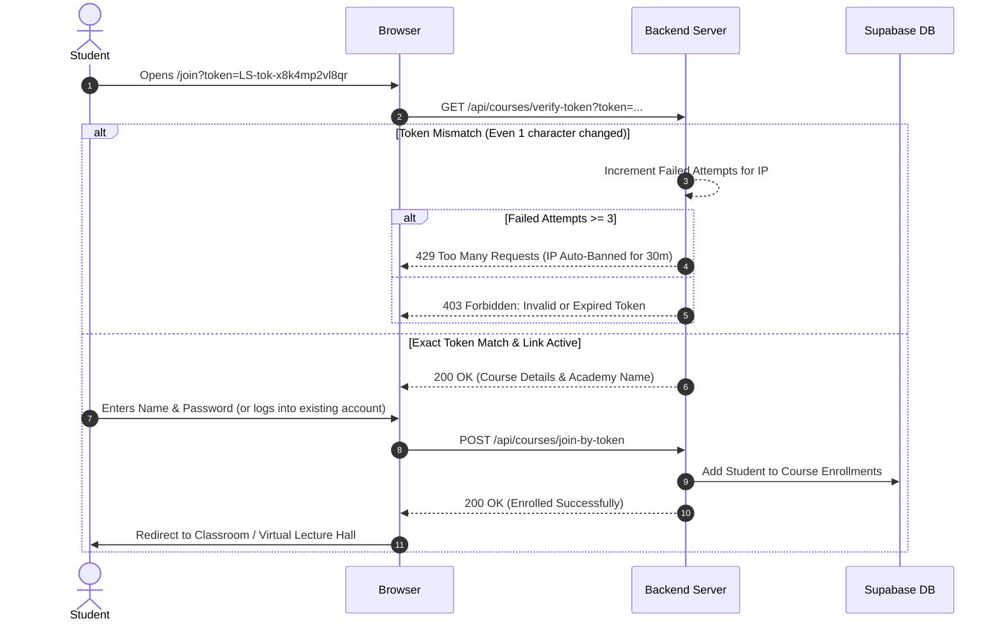
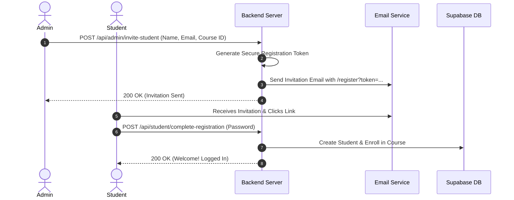
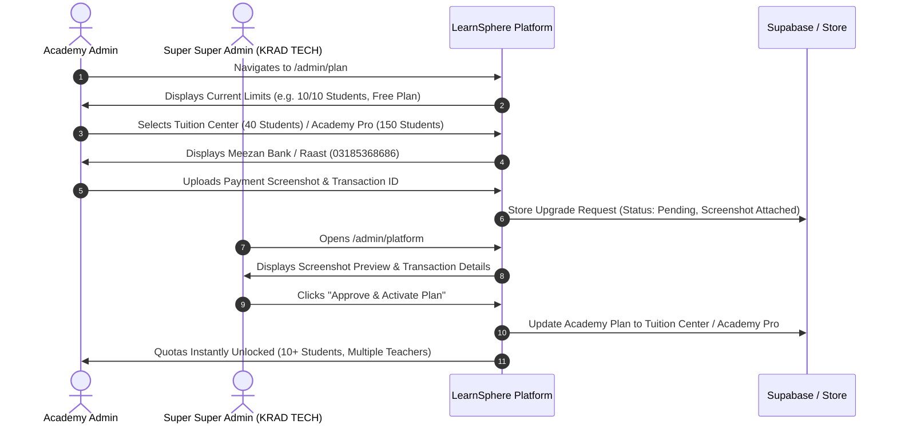

# Final Implementation Plan: LearnSphere Platform Security, Subscriptions & Onboarding

## User Decisions Confirmed:
1. **Exact Token Match**: Cryptographically secure, high-entropy tokens (e.g. `LS-tok-x8k4mp2vl8qr`). A 1-character difference instantly results in `403 Forbidden`.
2. **3-Attempt IP Auto-Ban**: Any IP making 3 invalid token attempts within 10 minutes is blocked.
3. **Direct Enrollment via Link**: No teacher approval queue needed — students with a valid link enroll directly into the class.
4. **Regenerate Link**: Teachers/Admins can click "Regenerate Link" at any time to invalidate the previous link.
5. **Invite-Only Mode Toggle**: Academies can toggle Class Links ON/OFF. When OFF, student enrollment is strictly invite-only.
6. **Add Student (Invitation Email Flow)**: Admin inputs student name & personal email $\rightarrow$ student receives an invitation email with a secure link to register their password and complete their profile.
7. **Single Student Account Architecture**: A student has ONE login and password. They can join multiple classes across multiple teachers with that same account.
8. **Class Upgrade Plan Screen (`/admin/plan`)**: When an academy reaches Free tier limits (10 students, 1 teacher, 1 course), they can upgrade to Tuition Center (40 students) or Academy Pro (150 students), view Bank / Raast transfer details, and upload their payment screenshot.
9. **Super Super Admin Control Center (`/admin/platform`)**: Platform owners (KRAD TECH) can inspect all platform classes, view academy plan tiers, manually update plans, and review uploaded payment screenshots.

---

## Architecture & Workflows

### 1. Class Join Link & High-Entropy Token Workflow

---

### 2. Add Student (Email Invitation) Workflow

---

### 3. Upgrade Plan & Payment Screenshot Verification Workflow

---

## Detailed File Changes

### Component 1: Backend Security & Platform Management
* **`backend/src/utils/security.js`** [NEW]
  * High-entropy token generator (`crypto.randomBytes`).
  * In-memory / cache IP rate limiter and 3-attempt auto-ban ledger.
  * Token verification helper.
* **`backend/src/routes/superAdminRoutes.js`** [MODIFY]
  * Add `/platform/overview`: Platform-wide classes, students, teachers, and plans.
  * Add `/platform/upgrade-requests`: List pending upgrade requests with screenshots.
  * Add `/platform/approve-upgrade`: 1-click plan activation.
  * Add `/platform/reject-upgrade`: Reject request with feedback.
  * Add `/platform/update-plan`: Manual plan override.
* **`backend/src/controllers/superAdminController.js`** [MODIFY]
  * Handlers for platform overview, plan approval, and screenshot retrieval.
* **`backend/src/routes/coursesRoutes.js` & `backend/src/controllers/coursesController.js`** [MODIFY]
  * Endpoint `GET /api/courses/verify-token`: Verifies token against rate-limiter and database.
  * Endpoint `POST /api/courses/join-by-token`: Enrolls student directly.
  * Endpoint `POST /api/courses/:id/regenerate-token`: Revokes old link and generates new high-entropy token.
  * Endpoint `POST /api/courses/:id/toggle-public-link`: Enables/disables public link (Invite-Only toggle).

### Component 2: Frontend Super Super Admin & Plan Upgrade Screens
* **`src/app/admin/platform/page.tsx`** [NEW]
  * **Super Super Admin Platform Center**:
    * Global summary cards (Total Classes, Total Academies, Total Students, Pending Approvals).
    * Class directory table with active plan badges and student capacity.
    * **Payment Verification Modal**: High-res preview of uploaded payment screenshot, transaction ID, bank details, and Approve/Reject buttons.
* **`src/app/admin/plan/page.tsx`** [NEW]
  * **Academy Plan Upgrade Screen**:
    * Quota progress meters (Student, Teacher, Course usage).
    * Free vs. Tuition Center vs. Academy Pro comparison.
    * Bank credentials card (Meezan Bank / Nayapay / Raast `03185368686`, KRAD TECH).
    * **Screenshot Upload Widget** with file dropzone, image preview, and Transaction ID input.
    * Real-time submission status banner (*"Under Review by Platform Admin"*).
* **`src/components/courses/ShareClassModal.tsx`** [NEW]
  * Modal for Admin & Teachers:
    * High-entropy link with 1-click Copy.
    * WhatsApp Share button.
    * **Invite-Only Toggle** (Enable/Disable Public Link).
    * **Regenerate Link Button** with confirmation alert.

### Component 3: Student Join Experience & Landing Page
* **`src/app/join/page.tsx`** [NEW]
  * Clean, responsive student join page for `learnsphere.com/join?token=...`.
  * Verifies token with backend rate limiting.
  * Allows existing students to join with 1 click, or new students to input name & password.
* **`src/components/landing/LandingNavbar.tsx` & `src/components/landing/LandingPageClient.tsx`** [MODIFY]
  * Add "Create Class Free" CTA in navbar and hero.
  * Quick class launch modal.

---

## Verification Plan

### Automated & Manual Verification
1. **Security & Token Tampering Test:**
   * Test with valid token: Confirm enrollment succeeds.
   * Modify 1 character in token: Confirm immediate `403 Forbidden` and no student is created.
   * Try 3 invalid tokens in succession: Confirm IP is auto-banned (`429 Too Many Requests`).
2. **Invite-Only Mode Test:**
   * Toggle class link to "Invite-Only".
   * Visit join link: Confirm page shows *"This class is invite-only. Please contact your instructor."*
3. **Regenerate Link Test:**
   * Click "Regenerate Link" in Share Modal.
   * Confirm old link is rejected and new link works.
4. **Plan Upgrade & Screenshot Flow Test:**
   * Submit an upgrade request on `/admin/plan` with a payment screenshot.
   * Open `/admin/platform` as Super Super Admin, view the full-res screenshot, and click "Approve".
   * Confirm the academy's capacity is immediately unlocked for 10+ students.
